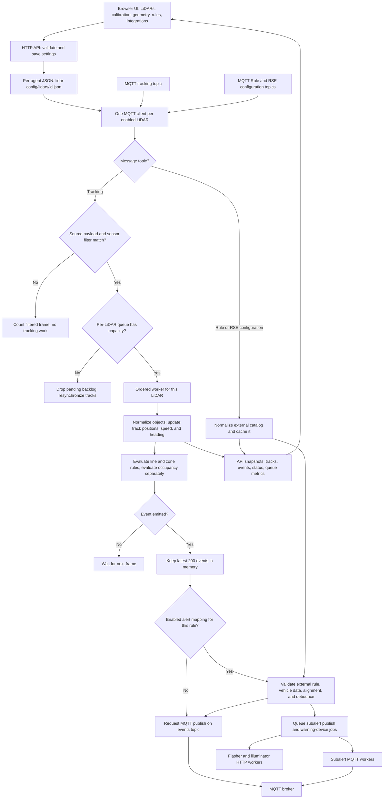
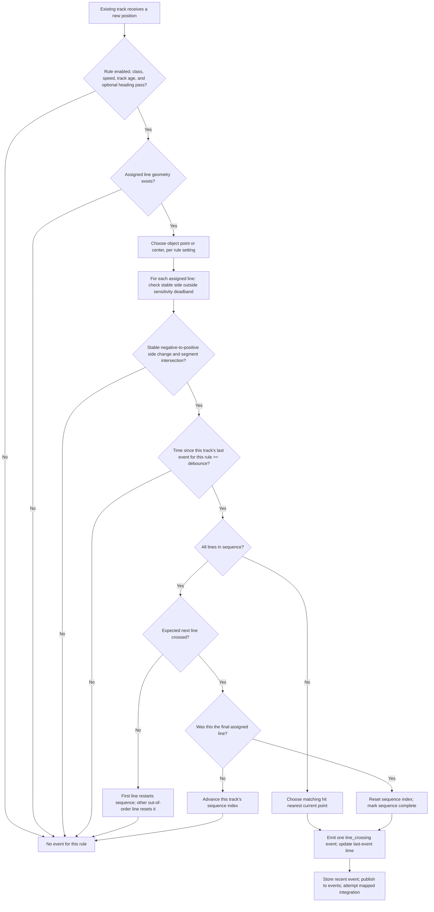
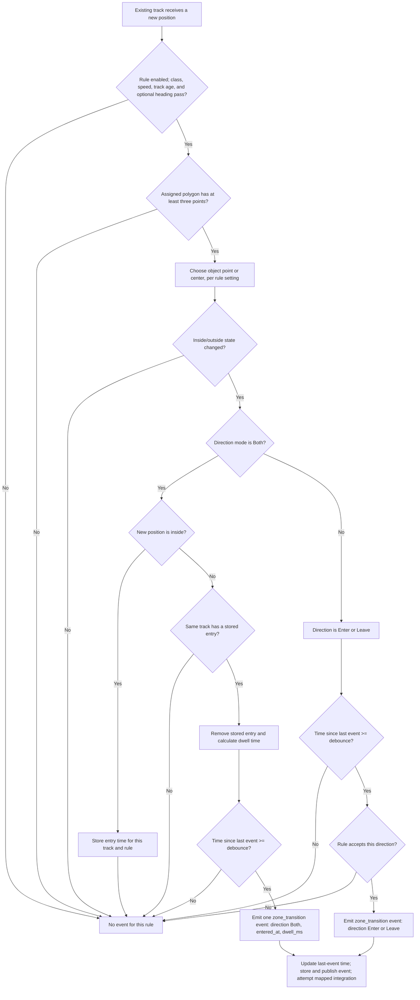

# Kyra LiDAR Agent Workflow Diagrams

These diagrams describe the current implementation, not a proposed architecture. Open this file in a Markdown viewer with Mermaid support to render the flowcharts.

## Application Workflow

The MQTT callback filters by Flasheye `header.frame_id` before queue admission. Each LiDAR's worker preserves its frame order; different LiDARs can process independently. A full queue drops the incoming frame and pending backlog, then resets track state before fresh frames. Integration jobs are bounded, asynchronous, and lost on restart. A normal event still goes to `events` when its optional integration mapping is unavailable or skipped.

## Line-Crossing Rule

The first sample of a new or reset track only establishes its position. `forward_hint` defines the signed side of each line segment; the detector requires a stable negative-to-positive crossing beyond `crossing_sensitivity_m`, then checks segment intersection with `endpoint_padding_m`. The event's `direction` comes from the line's `line_direction` setting; line rules do not have a separate direction filter. Sequence state and debounce are per track and per rule. A track reset clears both.

## Zone-Transition Rule

`Any` emits separate Enter and Leave events, subject to debounce. `Entering` accepts only Enter; `Leaving` accepts only Leave. `Both` emits only after the same track enters and later leaves. In `Both` mode the stored entry is consumed on exit before debounce is checked, so a debounced exit does not remain pending. Starting inside a zone does not create a stored entry. A track reset clears entry state.

## Timing And Persistence

- Track identity is `(frame_id, sensor_id, object_id)`. A new track is created for a missing ID, non-increasing timestamp, gap over `max_gap_sec` (default 5 seconds), or position jump over `max_jump_m` (default 25 meters).
- The engine fallback debounce is 1,500 ms for line crossing and 2,000 ms for zone transition when a rule omits `debounce_ms`; configured rule values take precedence.
- Recent events and active tracks are in memory. Per-LiDAR settings are persisted in `lidars/<id>.json`; the external Rule/RSE catalog is cached separately in `integrations-cache.json`.
- Subalert mapping is optional and applies to line-crossing and zone-transition events. It requires an active external rule, a vehicle class, map alignment, position, and heading. Mapping debounce is per mapping across all objects.

Implementation references: [app.py](app.py), [processing.py](processing.py), [sources.py](sources.py), [engine.py](engine.py), [integrations.py](integrations.py).
